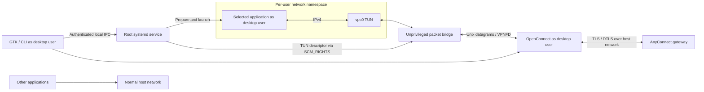
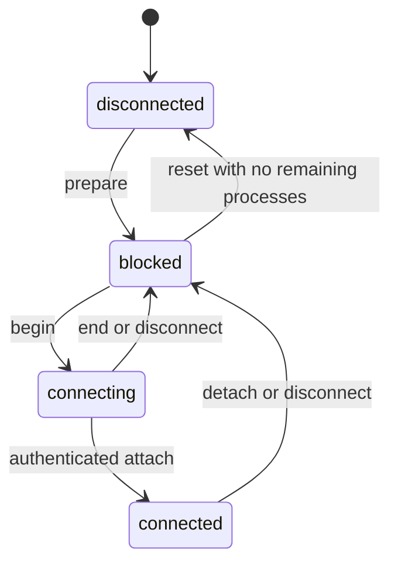

# Architecture

This document primarily describes the **implemented Linux V1**, using Python 3.11+, GTK 3/VTE, OpenConnect and a root systemd service. A native SwiftUI macOS configuration preview now exists; its network adapter, Windows, Rust and Tauri remain prospective. See the [macOS guide](docs/v1-macos.md) and [original study](docs/research-and-design.md).

## Contract and boundaries

Applications launched through VPN Splitter use the VPN or remain blocked. Other applications keep the host network. Selection happens before execution; existing processes/connections are not migrated. The application does not install a global VPN route, NAT or host DNS configuration.

A separate network namespace does not separate application singletons or all shared desktop services. Dedicated application profiles are also required. Native Chrome coexistence has been reported working by the user; generic applications and Codex/ChatGPT require further validation. This is network isolation for cooperative applications, not a hostile-code sandbox.

## Components

| Module | Responsibility |
| --- | --- |
| `gui.py` | GTK profiles/application list, status polling, VTE authentication and quit warnings |
| `cli.py` | CLI, OpenConnect supervision and internal helper entry points |
| `model.py` | Validated profiles, application arguments and gateway IPv4 configuration |
| `ipc.py` | Bounded Unix seqpacket messages, peer identity and descriptor passing |
| `service.py` | Per-UID sessions, connection tokens, authorization, state and lifecycle |
| `linux.py` | Namespace/TUN operations, resolver mounts, privilege dropping and exec |
| `bridge.py` | Unprivileged packet relay between OpenConnect and the isolated TUN |
| `instances.py` | Persistent VPN application data and managed Chrome/VS Code arguments |
| `tools/recover_desktop.py` | Explicit, targeted recovery through the normal user service manager |
| `macos.py` | macOS CLI diagnostics and refusal of unavailable networking commands |
| `native/macos/Sources/VPNSplitterCore/` | Native macOS profile validation/storage and explicit unavailable backend |
| `native/macos/Sources/VPNSplitterApp/` | SwiftUI configuration preview and static signature inspection |

The Python CLI dispatches to macOS before creating a Linux IPC client or loading the Linux adapter. Native macOS settings use a separate, versioned format under Application Support; they are not silently imported from Linux profiles. There is no macOS privileged service, Network Extension, VPN connection or protected application launcher in this milestone. The Linux packet path and lifecycle below do not apply to the macOS preview.

## Control and packet paths

The service creates `vps-UID`, containing `lo` and `vps0`, with IPv6 disabled and no direct interface. OpenConnect remains outside that namespace. Its `--script-tun` hook obtains the TUN descriptor from the service, then forwards complete IP datagrams. The bridge rejects non-IPv4 packets and drops packets under backpressure rather than delaying revocation or splitting packets.

OpenConnect uses `--queue-len=10` to avoid optional vhost-net acceleration, `--disable-ipv6`, `--no-proxy` and a disabled CSD wrapper. Password/OTP interaction happens in VTE or the invoking terminal. Browser SSO and posture checking are outside V1.

## Local protocol and privilege boundary

`/run/vpn-splitter/control.sock` is an `AF_UNIX/SOCK_SEQPACKET` socket restricted by the `vpn-splitter` group. Kernel `SO_PEERCRED` identifies each caller. The client verifies the service's root UID; the service derives the desktop UID from credentials and rejects root clients and unexpected request fields.

Protocol version 1 uses JSON objects with bounded packet sizes. `SCM_RIGHTS` passes TUN descriptors; received descriptors are made non-inheritable and unexpected descriptors are closed. Session tokens associate `begin`, `attach` and `end`, preventing stale connections from ending a newer attempt. The retained attach socket controls bridge lifetime.

The root service loads code only from a trusted, root-owned `/usr/lib/vpn-splitter` installation. It refuses symlinks and group/world-writable installation paths. Helpers receive only allowlisted display/locale environment values, never arbitrary environment injection or a root shell command.

## Application launch order

1. Validate the requested arguments, environment and session state.
2. Start the installed helper inside `vps-UID`.
3. Create a private mount namespace with read-only resolver/NSS bind mounts and mask nscd.
4. Set the user's environment, disabling session D-Bus/portal delegation.
5. Initialize the user's supplementary groups, set GID/UID and enable `no_new_privs`.
6. Create private application directories as the user and add managed profile arguments.
7. Execute the absolute application path; a close-on-exec handshake reports preparation failures.

Resolver configuration uses `hosts: files dns` and gateway-provided IPv4 DNS servers. Resolver files retain their inode when updated so existing bind mounts see the new content. They are readable after privilege dropping while their runtime parent remains root-private.

## State and failure handling

Service restoration blocks saved sessions; it never assumes a persisted namespace is connected. The bridge exits on control-socket loss, and the kernel signals the hook when its OpenConnect parent dies, including SIGKILL. The namespace has no direct egress to fall back to.

The systemd unit preserves runtime state and uses `KillMode=process` so remaining applications retain their isolation. Status counts namespace processes, including orphan/background descendants. Reset refuses to remove a live session. Closing the GUI window hides it; Quit warns about remaining processes and waits for the disconnect request before exiting. Quit does not terminate every protected application or return it to direct networking.

## Data and configuration

| Path | Contents |
| --- | --- |
| `~/.config/vpn-splitter/*.json` | Connection profiles and saved application commands; no VPN passwords/cookies |
| `~/.local/share/vpn-splitter/instances/<key>/` | Persistent private XDG and managed user-data directories |
| `/run/vpn-splitter/sessions/UID/` | Root-owned session metadata and isolated resolver/NSS files |
| `/run/netns/vps-UID` | Named per-user network namespace |

`XDG_CONFIG_HOME` can relocate connection profiles. Application-data roots use the account's home directory, with stable keys shared by recognized Chrome aliases. Data is per user/application, **not per VPN connection profile**, so two VPN connection profiles reuse that application's VPN data. Personal profiles are not copied; VPN application data can contain accounts/cookies saved by the application itself.

## Distribution, testing and future work

The Debian package installs the launcher, Python modules, systemd unit, desktop entry, icon, license and documentation. External runtime packages retain their own licenses; original repository material is MIT licensed. Installation/upgrades restart the service, so communication applications must be recovered first if they still depend on the tunnel.

`make check` covers validation, state, credentials, descriptors, privilege ordering and packaging. Disposable namespace checks exercise TUN and ocserv; Xvfb exercises GTK/VTE. Tests have different guarantees: ocserv is not Cisco/OTP certification, and argument planning is not actual application coexistence. See the [validation record](docs/validation-linux.md) and [issue tracker](docs/issues.md).

Next work includes Codex/ChatGPT singleton and shared-service validation, VS Code coexistence, persistent sign-in tests and recovery during sleep/network changes. New OS backends require their own network primitives, DNS policy, installation and failure validation; a portable GUI alone does not provide them.
