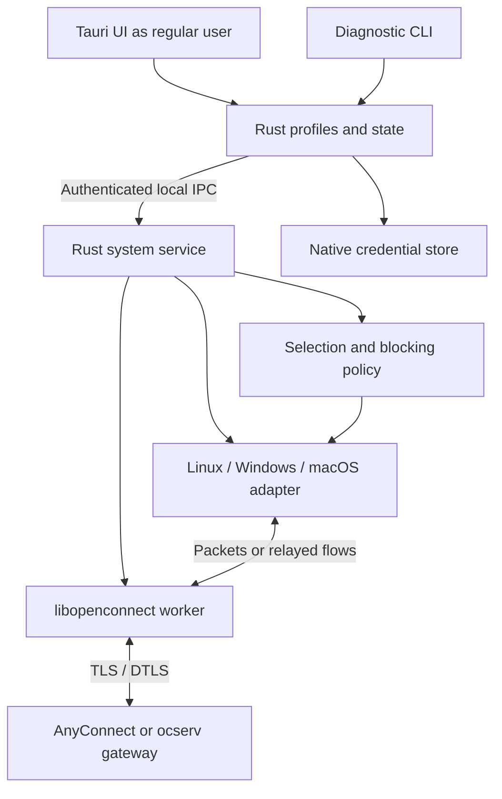

# VPN Splitter — research and proposed cross-platform design

Original study: November 3, 2026, before the network prototype. This is a **prospective design**, translated into English for the repository. The implemented Linux Python/GTK V1 is described in [architecture.md](../architecture.md), the [Linux guide](v1-linux.md) and [validation record](validation-linux.md). Tauri/Rust and Windows/macOS plans below are not implemented.

Confirmed priority: **chosen applications use the VPN; other applications stay direct**. Eventual targets: Linux, macOS and Windows. First protocol: Cisco AnyConnect through OpenConnect.

The study uses the cited public documentation and repositories. The listed clients were not installed or tested across all three operating systems during this research. An advertised feature is not a guarantee demonstrated by this project. Project/license descriptions are the original research snapshot, not a continuously maintained market survey.

## 1. Proposed decision

For a future cross-platform product, use **Tauri 2/TypeScript for the interface, Rust for the core/system service and libopenconnect for the tunnel**, with OS-specific network adapters. Tauri is a framework; Rust and Python are languages, so these are not mutually exclusive choices at the same level.

Reuse OpenConnect rather than reimplement AnyConnect. Its protocol/platform support does not guarantee compatibility with every Cisco configuration, authentication method or posture policy. See [OpenConnect](https://www.infradead.org/openconnect/) and [platform support](https://www.infradead.org/openconnect/platforms.html).

Recommended sequence: prove feasibility on all target OSes, deliver a usable Linux MVP, then validate Windows and macOS independently. A portable GUI does not make the networking behavior portable. If identical transparent selection is required at the first release on all three OSes, retain that scope explicitly and budget a larger project; IP routing or a proxy does not meet the same contract.

The subsequent Linux-only delivery deliberately chose Python/GTK for the initial implementation instead of immediately building the proposed Rust stack.

## 2. Existing free and open-source projects

“Free” here refers to software availability. Enterprise gateway access or a VPN subscription is a separate matter. Published source does not automatically make an entire product free or open source.

| Project | Documented scope in the original study | Licensing / cost snapshot | Relevance and limits |
| --- | --- | --- | --- |
| [OpenConnect](https://www.infradead.org/openconnect/) | Client/library, AnyConnect, Linux/macOS/Windows among other platforms | LGPL-2.1; free/open source | Recommended tunnel engine; application selection must be built around it |
| [OpenConnect GUI](https://gui.openconnect-vpn.net/) | Qt interface; site focused on Windows, macOS port; current repository on GitLab | GPLv2 in the [historical repository](https://github.com/openconnect/openconnect-gui); free | Existing client worth evaluating; no application selector documented in the examined pages |
| [Openconnect-RS](https://github.com/hlhr202/Openconnect-RS) | Rust/Tauri/React; advertised Linux/Windows/macOS GUI; password/OIDC authentication | LGPL-2.1 core, MIT OIDC component; public source | Close to the proposed stack; no per-app split documented in its examined README; build/privilege/maintenance audit required |
| [vpn-slice](https://github.com/dlenski/vpn-slice) | Python OpenConnect/vpnc script selecting hosts/subnets; advertised Linux/macOS/FreeBSD | GPLv3; free/open source | Useful for destination selection, not application selection; no Windows claim |
| [ocproxy / vpnns](https://github.com/cernekee/ocproxy) | SOCKS/port forwarding for OpenConnect; experimental Linux application namespace launcher | Three-clause BSD for ocproxy; third-party inventory needed | Relevant proof of concept; proxy requires compatible/configured applications; vpnns is Linux-only and experimental |
| [NetworkManager-openconnect](https://networkmanager.dev/docs/vpn/) | Linux NetworkManager integration | Open-source ecosystem; record component licenses for chosen versions | Convenient Linux connection management, not a three-OS application selection engine |
| [Mullvad app](https://github.com/mullvad/mullvadvpn-app) | Documented per-app split on Linux/Windows/macOS | GPLv3 application; paid VPN service | Rust/native adapter reference; excludes applications from a global VPN, the inverse direction; not a generic AnyConnect client |
| [PIA Desktop](https://github.com/pia-foss/desktop) | Cross-platform split; published [macOS extension](https://github.com/pia-foss/mac-split-tunnel) | Original code GPLv3 with other component licenses; paid service | Native integration reference, particularly macOS; does not directly supply this AnyConnect product |
| [GlobalProtect-openconnect / GP Connect](https://github.com/yuezk/GlobalProtect-openconnect) | Rust/OpenConnect, SSO/MFA, Linux/macOS among targets | Free/open CLI; paid and partially proprietary GUI in the examined offer | GlobalProtect-specific technical reference; does not satisfy an entirely free/open GUI requirement |

Additional source references: [ocproxy license](https://github.com/cernekee/ocproxy/blob/master/LICENSE), [PIA licenses](https://github.com/pia-foss/desktop/blob/master/LICENSE.txt), [GP Connect licensing](https://github.com/yuezk/GlobalProtect-openconnect#licensing).

Among the examined projects, the study did not identify a ready-to-use combination of a free/open GUI, AnyConnect and inclusive application selection across all three OSes. This is not an exhaustive proof of absence. The integration and guarantees are the principal work.

Do not rank maintenance by stars. Before adopting a fork, inspect usable releases, recent contributions, platform CI, blocking issues and reproducible packaging. The original documentation review alone was insufficient to rank all projects by effective maintenance.

## 3. Functional contract

Example: a dedicated Work Firefox instance and SSH client use the VPN, while a personal browser and media player stay on the normal connection.

| Situation | Required behavior |
| --- | --- |
| Selected application, healthy tunnel | Supported network traffic uses the VPN |
| Selected application before connection, during reconnect or after failure | Blocked; no automatic direct fallback |
| Unselected application | Direct traffic; no default global tunnel |
| Window close | Control remains available without silently disconnecting; tray where supported |
| Selection change | Apply before new traffic; request application restart when needed |
| VPN gateway without Internet egress | Only gateway-authorized destinations are available |

Selection must precede the first network packet. A **Launch in VPN** workflow is acceptable for MVP; live migration of running processes is not. Singleton browsers need separate data profiles and independent processes.

An IP route can affect all applications and is not an application rule. A browser SOCKS setting does not prove that extensions, helper services and every other flow follow it. The scope covers supported processes and descendants. Delegation to external system services must be tested or declared unsupported. This is not a sandbox against malicious applications.

## 4. Technology options

| Option | Assessment | Proposed role |
| --- | --- | --- |
| Tauri 2 + Rust + TypeScript | Shared UI/compiled core; native networking still required | Preferred future cross-platform stack; Svelte or React according to team skills |
| Rust + native Rust GUI | Fewer languages; OS networking differences remain | Valid alternative for a Rust-focused team |
| Python + PySide6 | Fast orchestration/prototyping; privileged service, system APIs and packaging still needed | Laboratory alternative; Python/GTK was later selected for Linux V1 |

This is engineering judgment, not a measured benchmark. No GUI framework supplies application splitting by itself. See [Tauri architecture](https://v2.tauri.app/concept/architecture/).

## 5. Proposed future architecture

Separate user control, privileged policy enforcement and packet transport. JavaScript does not handle packets.



- **User interface/core:** profiles, application selection, interactive authentication, state and diagnostics. Configuration stores secret references; native keychains store secrets if persistence is introduced.
- **System service:** validates requests, prepares interfaces/protection, starts processes with the correct identity, supervises and cleans up. Native installation/authorization differs by platform: systemd/polkit, Windows service, launchd/extensions.
- **Policy engine:** initially `selected application → VPN or blocked`, `other applications → direct`. Reject guarantees the OS adapter cannot enforce.
- **OS adapters:** process selection, tunnel/relay, DNS, filtering, installation and crash recovery, with explicit capability declarations.
- **Tunnel worker:** pinned libopenconnect and Rust FFI in a separate process to contain C-library failures; privileges reduced as far as the adapter permits.

Use protected Unix sockets and peer credentials on Unix; ACL-protected named pipes and client identity on Windows. Keep a versioned, narrow API. No arbitrary shell execution. Application execution uses the desktop user's rights, never the service identity.

Start feasibility work with the official supervised OpenConnect executable. A future libopenconnect worker offers structured authentication/network callbacks instead of depending on log text. Its public API includes `openconnect_setup_tun_fd`, authentication callbacks and statistics; every backend needs a prototype. See the [public header](https://github.com/openconnect/openconnect/blob/master/openconnect.h).

Adapters own routes and DNS. Do not also run a script installing a global route. Reduce privileges for network-exposed code; [OpenConnect documents non-root operation](https://www.infradead.org/openconnect/nonroot.html). Passwords/cookies belong in memory or protected IPC, not process arguments. Require TLS verification and support private CAs. Browser authentication, if added, must not load remote SSO pages into a privileged UI WebView.

## 6. OS-specific strategy

### Linux

Proposed and subsequently implemented principle: an isolated application network namespace with its TUN and default route, while OpenConnect's TLS/DTLS sockets remain in the host network. Transfer the TUN descriptor to the unprivileged packet transport.

Data path: selected application → namespace TUN → host-side OpenConnect → gateway. No direct host NAT/veth path is needed. Enter isolation before exec, close inherited network descriptors, return user privileges and provide isolated DNS/NSS. Retain only necessary graphical Unix access and document shared-service limitations.

Tunnel failure leaves applications without direct egress. Cleanup must not reconnect them to the host network. See [kernel TUN documentation](https://docs.kernel.org/networking/tuntap.html) and [experimental vpnns](https://github.com/cernekee/ocproxy#vpnns-experimental). A later cgroup/mark/policy-routing backend may improve desktop integration but adds classification, startup and DNS difficulties; it is not an automatic replacement.

### Windows

Windows Filtering Platform provides application-related enforcement and redirection points. Advanced transparent redirection may require a callout driver and control service. TUN/TAP carries packets but does not select their source applications. See [ALE layers](https://learn.microsoft.com/en-us/windows/win32/fwp/ale-layers) and [connection redirection](https://learn.microsoft.com/en-us/windows-hardware/drivers/network/using-bind-or-connect-redirection).

Prototype classifying new selected-executable connections, redirecting to a service-only local relay and converting TCP/UDP flows into OpenConnect packets. Preserve original destinations/return paths, avoid relay loops, reject direct fallback and evaluate an existing network stack rather than rewriting TCP. Compare this with WFP tunnel binding and controlled routing, proving that an unselected application reaches the same destination directly.

The [Mullvad split driver](https://github.com/mullvad/win-split-tunnel) is a GPLv3+/MPL-2.0 reference for exclusion, not a drop-in inclusive implementation. Driver modification/distribution needs signing and validation from the prototype onward. See [Microsoft signing requirements](https://learn.microsoft.com/en-us/windows-hardware/drivers/install/kernel-mode-code-signing-requirements--windows-vista-and-later-).

### macOS

Prototype a transparent-proxy **Network Extension** with a small Swift API layer. Identify originating applications, intercept chosen TCP/UDP flows and relay them to OpenConnect while leaving other traffic direct.

The [PIA extension](https://github.com/pia-foss/mac-split-tunnel) is a concrete reference, not proof of inclusive OpenConnect compatibility. PF filtering alone should not be assumed to provide reliable application selection. Validate entitlements, installation, signing, notarization, crash/disable behavior and persistent blocking. Determine during prototyping whether a complementary filter is required. See [Apple Network Extension entitlements](https://developer.apple.com/documentation/bundleresources/entitlements/com.apple.developer.networking.networkextension).

Shared helpers, including some WebKit operations, need individual validation. See [Mullvad's split limitations](https://github.com/mullvad/mullvadvpn-app/blob/main/docs/split-tunneling.md). Do not promise support for every application before testing.

## 7. DNS, IPv6 and guarantees

DNS is a core product concern. Shared resolver services may hide the originating application from process filters. Linux MVP uses isolated resolution through VPN DNS and leaves host DNS unchanged. Windows/macOS prototypes must choose either proven per-application resolution or explicitly documented suffix-based split DNS. Suffix rules can affect unselected applications and do not constitute strict per-app separation. Unsupported strict configurations must remain unsupported.

Start with IPv4. If a gateway/backend lacks IPv6 support, block it for protected applications while preserving direct-app IPv6. Test UDP, QUIC, built-in DNS/DoH, literal addresses and helpers. Domain/PAC policy is later work.

Validate all gateway-supplied network settings. The client controls its own local routes, not gateway ACLs or enterprise requirements for official clients/posture checks.

## 8. Delivery scope

### Feasibility stage

Before an elaborate cross-platform interface:

1. Connect against ocserv and at least one representative Cisco gateway.
2. Prove selected/direct paths to the same destination using capture/server logs.
3. Test TCP, UDP, DNS and IPv6 transport or explicit blocking.
4. Kill the tunnel/worker/service, and disable the extension/driver where applicable; prove no protected direct fallback.
5. Validate distributable installation, permissions and signing on standard machines.

Deliver a small laboratory executable per OS, captures, reproduction steps, limitations and a scope decision. Proxy-only operation is not proof of transparent application selection.

### Linux MVP

Include stored AnyConnect profiles (address/group/CA/bounded options), one active tunnel, password and tested OTP forms, manual executable selection, launch-with-descendants within documented limits, IPv4 TCP/UDP, isolated VPN DNS, IPv6 transport or blocking, reconnect/failure protection, status/errors/tray, diagnostics without secrets and a system package/service. Reference applications start with curl/SSH and a separate browser profile. Browser SSO enters scope only if explicitly implemented and validated; the current V1 excludes it.

Initial Linux delivery was proposed as Ubuntu LTS x86_64; current validation used Ubuntu 24.04. Windows/macOS should first ship explicitly limited validation releases. A cross-platform V1 needs equivalent inclusion/failure tests, supported-app lists, explicit DNS limits and usable installers without disabling OS security. Initial future targets: Windows 11 x86_64 and selected Apple Silicon macOS versions; additional architectures extend the maintenance matrix.

### Out of initial scope

- Live migration of running processes/connections; multiple simultaneous VPNs or tunnel chains.
- Protocols beyond validated AnyConnect, despite wider OpenConnect support.
- A general domain/URL/port/application rule engine.
- Universal Cisco posture, PKI/smart-card and SSO compatibility.
- Containers, Flatpak/Snap, WSL, VMs or unvalidated shared-service applications.
- Browser-tab selection, protection from hostile applications, a hosted VPN service, cloud accounts or subscriptions.

## 9. Acceptance criteria

| Test | Required outcome |
| --- | --- |
| Selected and direct applications, same server/port | Distinct VPN/direct paths |
| Internal/public DNS | Matches declared platform DNS contract; no internal names on direct DNS in protected scenarios |
| Tunnel loss during transfer | Protected application blocked; direct application operational |
| Worker/service/extension crash | No direct fallback; explicit recovery available |
| IPv6-capable LAN | Protected IPv6 tunneled or blocked; direct IPv6 preserved |
| Children, existing browser and helpers | Classification before emission; separate profile required or unsupported case rejected |
| Sleep, Wi-Fi/Ethernet changes, reconnect | No transient direct fallback; coherent user state |
| Repeated connect/disconnect | Only project-owned objects cleaned; third-party routes/DNS preserved |
| Unauthorized IPC | No networking changes or privileged execution |
| Uninstall | Components removed without silently returning protected applications to direct networking |

Use ocserv for automated integration and native/VM platforms for OS enforcement. Retain real Cisco testing. Measure throughput, latency, memory and reconnect behavior before setting performance thresholds.

## 10. Prospective code organization and operations

This tree is a future proposal, not the current repository:

```text
apps/desktop/             Tauri / TypeScript
crates/core/              profiles, policy, state and capabilities
crates/ipc/               local protocol and authentication
crates/service/           supervision and privileged operations
crates/openconnect/       Rust wrapper and libopenconnect worker
crates/platform-linux/    namespaces, TUN and DNS
crates/platform-windows/  service, WFP and relay
crates/platform-macos/    extension and relay
crates/flow-relay/        if Windows/macOS prototypes require it
native/windows/          potential callout driver
native/macos/            extension and Swift layer
tests/integration/       ocserv and networking scenarios
packaging/               installers and services
docs/                    decisions and validated compatibility
```

Common lifecycle concepts: disconnected, authenticating, preparing protection, connecting, connected, blocked reconnect, error and stopping. Report connected only once the declared tunnel/selection/DNS protections are installed. Identify project-owned objects for crash recovery.

Install protections before permitting traffic; preserve them during failure. Recovery removes only project-owned objects and offers to close affected applications before lifting isolation. Updates must preserve that order. Pin native dependencies, document rebuilds, inventory components and provide signed updates. Native build environments remain necessary, especially for drivers/extensions.

## 11. Reuse, licensing and effort

Evaluate OpenConnect for transport, Openconnect-RS for a possible Rust wrapper, vpnns for Linux, Mullvad for Windows and PIA for macOS. Reuse useful components selectively rather than assuming a provider-specific client can simply be forked wholesale.

The original study suggested GPL-3.0-or-later as one possible future choice, subject to an exact dependency/reuse inventory; it did not apply a license. **The repository owner subsequently selected MIT for this project's original code and documentation.** That choice does not relicense dependencies or reference implementations. Any future imported code needs its own compatibility and attribution review.

Free use does not eliminate development, test hardware, signing, developer-account and distribution costs. The architecture requires no product subscription.

Original engineering estimates for one experienced full-time developer with all platforms and test gateways available (not a quotation):

| Workstream | Indicative effort |
| --- | --- |
| Three-OS prototypes, inventory and decision | 4–8 weeks |
| Linux MVP after successful prototype | 6–10 additional weeks |
| Windows backend/distribution | 8–16 additional weeks |
| macOS backend/distribution | 8–16 additional weeks |
| Cross-platform stabilization | 4–8 additional weeks |

Sequential total: 30–58 weeks, excluding external certification delays and major SSO incompatibilities. Reuse can reduce effort; a new driver, UDP/IPv6 relay or strict DNS separation can increase it. Re-estimate after prototypes; these estimates are not the implementation time of the current Linux proof of concept.
